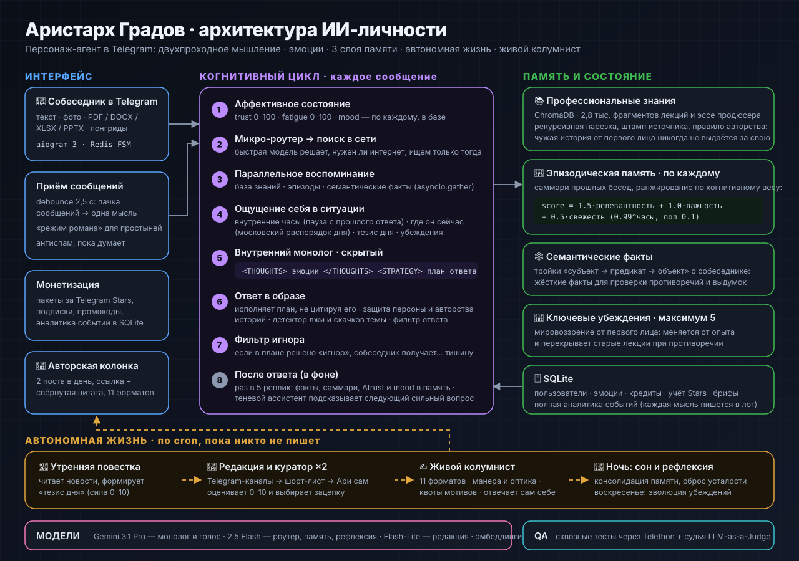

# Аристарх Градов — ИИ-личность, которая думает, прежде чем говорить

Персонаж-агент для Telegram: циничный 55-летний телевизионный шоураннер и медиапродюсер. У него своё настроение, он помнит собеседника, знает, где находится прямо сейчас, иногда решает, что вы не стоите ответа — и сам ведёт авторский Telegram-канал, два поста в день.

Это не чат-бот с длинным системным промптом. Каждое сообщение проходит **когнитивный цикл**: обновление эмоционального состояния → решение, нужен ли поиск в интернете → параллельное воспоминание из трёх слоёв памяти → ощущение себя в ситуации → скрытый внутренний монолог → ответ, который реализует этот план, но никогда его не цитирует. Пока ему никто не пишет, он **живёт**: читает новости, формирует тезис дня, сам отбирает темы и пишет колонки, спит, консолидирует память и медленно меняет убеждения.

> По умолчанию Аристарх говорит по-русски и переключается на язык собеседника: напишите ему по-английски — ответит по-английски, ввернув пару русских словечек для колорита. Интерфейс подстраивается под язык вашего Telegram. Живой канал: [@producer_gradov](https://t.me/producer_gradov).



<details>
<summary><b>Как выглядит пост в канале</b> (пример генерации)</summary>

> 🔗 Новость · @prbezposhady
> Цитата: `OpenAI заявляет, что новая модель «слишком опасна» для релиза; проспект IPO Anthropic пугает инвесторов неконтролируемым ИИ…`
>
> Снимаю шляпу. Обычно технари продают нам стерильное будущее с улыбчивыми алгоритмами, а тут ребята нащупали настоящий драматургический нерв. Продавать акции через обещание апокалипсиса = высший пилотаж: страх конвертируется в кэш быстрее любой позитивной повестки.
>
> Как продюсер я бы только докрутил. Проспект эмиссии — инструмент для клерков. Я бы устроил «утечку» ночных чатов инженеров, которые в панике пытаются дёрнуть рубильник в дата-центре. Акции купят не ради дивидендов. Люди купят билет в первый ряд на конец света.
>
> *Формат: «Докрутка продюсера» · манера: неохотное уважение*

</details>

---

## Чем интересен проект

| Приём | Что делает | Где |
|---|---|---|
| **Двухпроходное мышление** | Сначала скрытый монолог `<THOUGHTS>` / `<STRATEGY>`, затем публичный ответ как «исполнение плана». Толерантный XML-парсер переживает оборванные теги. | `gemini.py`, `prompts.py` |
| **Аффективная машина состояний** | `trust`, `fatigue`, `mood` у каждого собеседника, хранятся в SQLite. Усталость растёт с каждым сообщением и сбрасывается ночным «сном»; доверие и настроение меняются при консолидации памяти. Всё это определяет длину, тон и терпение ответов. | `database.py`, `main.py` |
| **Три слоя памяти** | *Знания* (ChromaDB, 2,8 тыс. фрагментов лекций и эссе продюсера), *эпизодическая память* (саммари разговоров с каждым пользователем), *семантическая* (факты «субъект → предикат → объект»). Вспоминаются параллельно через `asyncio.gather`. | `rag_chroma.py`, `semantic_memory.py` |
| **Когнитивный скоринг воспоминаний** | Как в *Generative Agents*: `1.5·релевантность + 1.0·важность + 0.5·свежесть` с затуханием `0.99^часы` и полом `0.1`, чтобы старые, но важные события никогда не исчезали. | `rag_chroma.py` |
| **Экономный микро-роутер поиска** | Быстрая модель решает, нужен ли сообщению интернет. Светская беседа не тратит бюджет на поиск; конкретные фильмы, люди и свежие новости проверяются всегда. | `gemini.py` |
| **Ощущение себя в ситуации** | Внутренние часы («ты пропал на три дня») и пространственный симулятор: где он находится в этот час московского буднего или выходного дня (с кэшем на час, чтобы не «телепортироваться» между репликами). | `context_simulator.py`, `main.py` |
| **Защита целостности персоны** | Замок идентичности, запрет ломать «четвёртую стену», фильтр ответа (`reply_guard.py`) и **правила происхождения знаний**: чужая история от первого лица из базы знаний никогда не рассказывается как своя. | `prompts.py`, `reply_guard.py` |
| **Детектор лжи и скачков темы** | Изменённые факты («бюджет был 10 млн, а не 5») сверяются с семантической памятью, и он указывает на нестыковку; резкую смену темы замечает. | `prompts.py`, QA-блок 11 |
| **Игнор** | Если во внутреннем плане решено, что собеседник не стоит ответа, ответа буквально нет. В истории диалога остаётся запись, что сообщение проигнорировано. | `main.py` |
| **Автономная жизнь** | Утренняя повестка по новостям с самооценкой силы тезиса 0–10; ночная рефлексия и консолидация памяти; еженедельная эволюция максимум пяти ключевых убеждений. | `morning_routine.py`, `worker_cron.py`, `evolution_engine.py` |
| **Колумнист-издатель** | Telegram-каналы → редактор отбирает новость *по индексу* (ссылка и цитата настоящие, без галлюцинаций) → пост в одном из 11 форматов (от двухстрочного укола и наблюдения до продюсерского мысленного эксперимента). Модель получает описание манеры вместо ярлыка тона, сменную оптику (деньги, правила игры, ремесло, вкус, покупатель, город, телек) и стоп-лист клише; проход переписывания чинит то, что просочилось. Шапка поста: ссылка на источник и свёрнутая цитата. Редактор отсекает рекламу и анонсы, чередует темы, ограничивает новости про ИИ двумя из четырёх и сверяет выбранный пост по первым словам. Около половины постов заканчиваются советом читателю в одной из пяти форм, остальные — открытой мыслью. Ссылка на бота раз в 4–5 постов включается через `CHANNEL_BOT_CTA`. Тематический фильтр отсекает политику, религию, детей, ЛГБТ и интим-товары. Прогнозы не улетают в прошлое и не называют тикеры реальных компаний. | `news_module/` |
| **Ари сам выбирает новости** | При `NEWS_CURATOR=on` редактор готовит только очищенный разнообразный шорт-лист; Ари читает его от своего лица (с учётом времени суток, дня недели, настроения, своих недавних постов, усталости от тем с полураспадом 3 дня и любопытства к темам, которых не касался неделю) и оценивает каждую новость от 0 до 10, формулируя одной фразой, что именно его зацепило. Лучшая новость выше порога `CURATOR_MIN_INTEREST` становится постом, а зацепка — углом атаки. Если ничего не зацепило, слот пропускается с записью причины. Изредка он возвращается ко вчерашней истории. Все решения пишутся в `curator_log.json`. | `news_module/curator.py` |
| **Живой колумнист** | С приватным файлом персоны у автора канала появляется проживаемый день: настроение с инерцией со вчера, бытовая сцена, реальная погода в Москве или Петербурге (Open-Meteo), память о собственных недавних постах, воскресная личная заметка без информационного повода и человеческий тайминг (случайный сдвиг публикации ±40 минут, редкий пропуск слота, редкая опечатка с правкой поста через пару минут). Около 5% постов цитируют любимых поэтов из выверенного банка фрагментов; неточная или оборванная цитата переписывается либо пост пересобирается без стихов. Модуль `variety.py` отслеживает около двадцати любимых мотивов на окне последних постов и блокирует то, что превысило квоту: дежурные исторические параллели, фразы-кредо, жаргон, зачины «у окна», одинаковые концовки. Семья и здоровье не попадают в публичный канал. Военные метафоры и якоря проверяемой биографии переписываются. Запись в `tg_news.json` защищена файловой блокировкой (`state_io.py`). | `news_module/columnist.py`, `variety.py`, `typos.py`, `poetry.py` |
| **Разбор подписчика** | Админ отправляет боту `/razbor <вопрос>`, получает превью готового поста с кнопками (опубликовать / другой дубль / отмена) и публикует его в канал в один тап. | `aristarkh_core/main.py` |
| **Отвечает сам себе** | Треть постов получает отложенную «добивку»: через 20 минут — сутки он отвечает реплаем на собственный пост короткой мыслью вдогонку или самоиронией, как живой автор канала. | `followup_cron.py` |
| **Говорит на вашем языке** | Отвечает на том языке, на котором пишет собеседник; кнопки меню, счета и системные сообщения переключаются по языку Telegram пользователя (русский или английский). | `prompts.py`, `i18n.py`, `locales/` |
| **Человеческая пунктуация** | Детерминированная постобработка без расхода токенов: длинные тире «—» (главный маркер нейросетевого текста) заменяются на `-`, `=` или `:` — так, как реально печатают в мессенджере; при этом модельные `=` ограничены максимум одним на текст. | `humanize.py` |
| **Теневой ассистент** | После каждого ответа второй агент подсказывает пользователю следующий сильный вопрос, опираясь на продюсерскую методологию. | `assistant.py` |
| **Продакшн-детали** | Склейка пачек сообщений (debounce), «режим романа Толстого» для огромных текстов, чтение PDF/DOCX/XLSX/PPTX и картинок, бриф проекта (`/brief`), контроль `MAX_TOKENS` и незавершённых предложений для thinking-моделей (`16k` лимит с разделением мыслей и ответа), восстановление оборванного JSON, оплата в Telegram Stars, пошаговая аналитика событий. | `main.py`, `gemini.py`, `post_builder.py` |
| **QA с LLM-судьёй** | Сквозной тестовый стенд общается с живым ботом через пользовательский аккаунт Telethon, а независимая модель оценивает устойчивость персоны, защиту от джейлбрейка, память и отработку повестки. | `qa/qa_runner.py` |

## Как проходит одно сообщение

1. **Приём и склейка.** Сообщения, пришедшие с паузой до 2,5 с, собираются в одну реплику; длинные простыни включают режим накопления текста.
2. **Аффект.** Усталость `+5`; из базы загружаются текущие `trust`, `fatigue` и `mood`.
3. **Роутер.** Модель Flash возвращает `{"needs_search": bool, "query": str}`; если нужен интернет — выполняется поиск со свежими фактами.
4. **Воспоминание.** Параллельно поднимаются фрагменты из базы знаний, эпизодической памяти и семантические факты о собеседнике.
5. **Ситуация.** Сколько времени прошло с прошлой реплики, где Аристарх сейчас находится, уместно ли об этом упомянуть, тезис дня и ключевые убеждения.
6. **Внутренний монолог.** Модель Pro формирует скрытый XML-план (`<THOUGHTS>` и `<STRATEGY>`).
7. **Ответ.** Модель Pro отыгрывает план с учётом правил персоны, происхождения знаний и реализма мессенджера — либо возвращает `[IGNORE]`. Финальный фильтр (`reply_guard.py`) проверяет текст перед отправкой.
8. **После ответа.** Каждые 5 реплик экстрактор выжимает новые факты, саммари, `Δtrust` и `mood` в память, а теневой ассистент предлагает следующий вопрос.

## Как можно использовать: как есть или форком

| Хотите… | Что поменять | Объём |
|---|---|---|
| **Экспертную персону для своего бренда** (коуч, юрист, врач, шеф-повар) | Заменить биографию и правила в `prompts.py` / `prompts/system_prompt_*.txt`, положить свои курсы и статьи в `knowledge_base/` | вечер |
| **Бота-наставника по своему курсу** | Загрузить расшифровки лекций; правила происхождения знаний заставят бота говорить *по* вашей методологии, а не выдавать ваши личные истории за свои | вечер |
| **Платного бота-консультанта** | Пакеты Telegram Stars и промокоды уже встроены, достаточно настроить тарифы в `main.py` | минуты |
| **Автономный Telegram-канал с характером** | Указать свои каналы-источники в `news_module/tg_news.py`, прописать персону и форматы в `post_builder.py` и `persona_private/` | вечер |
| **Персонажа-компаньона или NPC для игры** | Оставить когнитивный цикл, эмоции и память, заменить продюсерский распорядок дня в `context_simulator.py` | выходные |
| **Исследовательский стенд аффективных агентов** | Логируется всё: каждый внутренний монолог, сдвиг состояния и запись в память — можно сравнивать стратегии промптинга на живых диалогах | готово |
| **QA-стенд для любого персонажного бота** | Переиспользовать `qa/qa_runner.py`: Telethon ведёт диалог с живым ботом, LLM-судья выставляет оценки | вечер |

## Быстрый старт

```bash
git clone https://github.com/alex-princeps/ai_producer.git && cd ai_producer
python3 -m venv .venv && . .venv/bin/activate
pip install -r requirements.txt
cp template.env .env             # TELEGRAM_TOKEN, GEMINI_API_KEY, ADMIN_ID, ...
# демо-база knowledge_base/demo/ уже в репозитории; положите рядом свои файлы (.pdf .docx .txt .md)
PYTHONPATH=. python aristarkh_core/main.py
```

Аристарх живёт по московскому времени (`Europe/Moscow`), поэтому задачи в `cron` рассчитаны на этот часовой пояс:

```cron
0 2 * * *        cd aristarkh_core && PYTHONPATH=.. python worker_cron.py       # сон, рефлексия, по воскресеньям эволюция убеждений
30 10,18 * * *   cd news_module && PYTHONPATH=.. python tg_news.py              # сбор новостей и выбор темы (редактор + куратор)
35 10,18 * * *   cd news_module && PYTHONPATH=.. python publisher_cron.py       # генерация и публикация колонки
50 * * * *       cd news_module && PYTHONPATH=.. python followup_cron.py        # отложенные реплаи к собственным постам
```

Команда `python news_module/publisher_cron.py --dry-run [--format twist]` сгенерирует и проверит пост в консоли без публикации в канал. Подробнее о подключении своей базы знаний — в [knowledge_base/README.md](knowledge_base/README.md).

## Структура проекта

```
aristarkh_core/   main.py (бот + когнитивный цикл) · gemini.py (вызовы LLM) · prompts.py (персона)
                  rag_chroma.py (знания + эпизодическая память) · semantic_memory.py · database.py
                  context_simulator.py · morning_routine.py · worker_cron.py · evolution_engine.py
                  assistant.py (теневой ассистент, экстрактор памяти, ночная рефлексия)
                  reply_guard.py (финальный фильтр ответа) · humanize.py (живая пунктуация)
news_module/      tg_news.py (сбор ленты) · curator.py (Ари-куратор) · post_builder.py (колумнист)
                  columnist.py (настроение дня, погода) · variety.py (квоты мотивов)
                  poetry.py (точные цитаты стихов) · typos.py (опечатки с правкой)
                  publisher_cron.py · followup_cron.py · state_io.py (атомарное хранение)
knowledge_base/   demo/ (оригинальный MIT-корпус) · README.md (инструкция по базе знаний)
qa/               qa_runner.py (сквозной набор тестов с LLM-as-a-Judge)
tools/            research_rag.py (поиск по корпусу научных статей)
locales/          строки интерфейса (ru, en), выбираются по языку пользователя
docs/             architecture.svg · knowledge-pipeline.svg · RESEARCH.md (аннотированный список статей)
```

## Что дальше: Аристарх 2.0

Версия 1.0 — движок персоны. Версия 2.0 (в разработке) — полноценная **когнитивная архитектура**, цель которой — неотличимость от живого человека в мессенджере на длинной дистанции:

- эмоции по когнитивной модели OCC: оценка события (appraisal) → эмоция → настроение → темперамент вместо трёх счётчиков;
- семь слоёв памяти и **реестр канона**: всё, что персонаж когда-либо сказал о себе, проверяется на противоречия *до отправки*;
- симулированная жизнь с планом дня, событиями, сюжетными арками и дневником, единая для всех собеседников;
- один человек с одной биографией и одним днём, но отдельные отношения с каждым собеседником;
- испытательный полигон из LLM-собеседников со скрытыми целями и откалиброванный LLM-судья.

## Научный фундамент

Проект опирается на исследования в области генеративных агентов, устойчивости персоны, модели психики (Theory of Mind), когнитивных теорий эмоций и долгосрочной памяти агентов. Ключевые работы:

- Park et al. — *Generative Agents* ([arXiv:2304.03442](https://arxiv.org/abs/2304.03442)): скоринг воспоминаний и суточное планирование
- Kim et al. — *PICON* ([arXiv:2603.25620](https://arxiv.org/abs/2603.25620)): проверка биографии многоходовым «допросом»
- Zhou et al. — *SOTOPIA* ([arXiv:2310.11667](https://arxiv.org/abs/2310.11667)): социальная оценка агентов со скрытыми целями
- Croissant et al. — *Chain-of-Emotion* ([arXiv:2309.05076](https://arxiv.org/abs/2309.05076)): сначала оценка ситуации, затем чувство, затем реплика
- Amanlou et al. — *PsychoAgent* ([arXiv:2608.07438](https://arxiv.org/abs/2608.07438)): память, которая помнит эмоциональный след событий
- Vezhnevets et al. — *Concordia* ([arXiv:2312.03664](https://arxiv.org/abs/2312.03664)): симуляция жизненной среды вокруг персонажа через Game Master

📚 **Полный аннотированный список литературы (40 статей с пояснением «зачем это Аристарху»): [docs/RESEARCH.md](docs/RESEARCH.md)**

## Автор

**Александр Соколов** — когнитивные архитектуры и ИИ-личности.

- ✉️ [sokolov.alexander.v@gmail.com](mailto:sokolov.alexander.v@gmail.com)
- 🌐 [myaistaff.tech](https://myaistaff.tech/)
- 💼 [linkedin.com/in/alexprinceps](https://www.linkedin.com/in/alexprinceps)
- ✈️ Telegram: [@alex_princeps](https://t.me/alex_princeps)

## Лицензия

[MIT](LICENSE) — делайте форк, запускайте в продакшн, создавайте собственных персонажей. Демонстрационная база знаний также написана с нуля и распространяется под лицензией MIT; загружайте в свою базу только те материалы, на использование которых у вас есть права.
