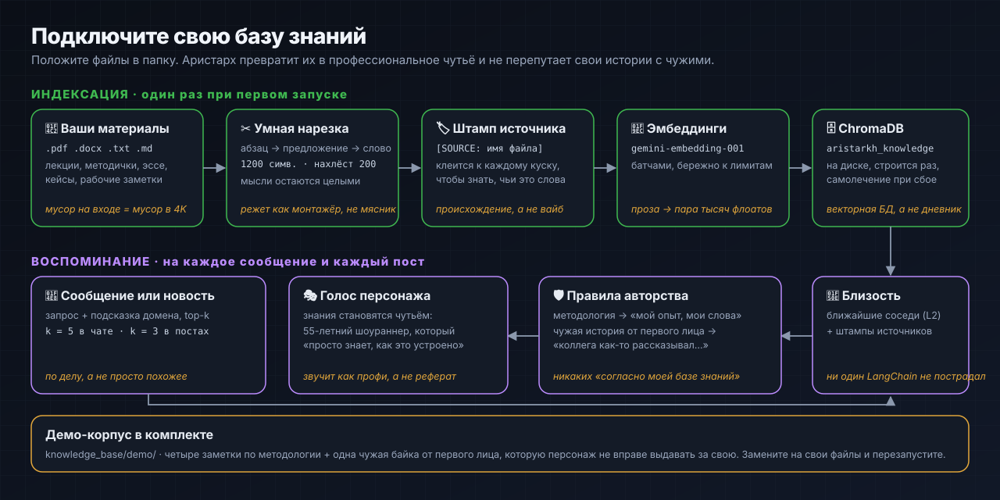

# База знаний: подключите свои материалы



Аристарх без базы знаний — это очень уверенный в себе мужчина без единого пруфа. Дайте ему свои лекции, методички и рабочие байки — и он заговорит как человек, который провёл 25 лет в аппаратной, не цитируя ваши PDF-файлы как студент на защите диплома.

## Коротко (TL;DR)

```bash
cp -r my_course_transcripts/ knowledge_base/my_stuff/   # .pdf .docx .txt .md
rm -rf aristarkh_core/chroma_db                         # только если переиндексируете уже работавшего бота
PYTHONPATH=. python aristarkh_core/main.py              # проиндексирует при первом старте и сразу запустится
```

Свой путь к папке можно задать через переменную `KNOWLEDGE_DIR=/abs/path/to/folder` в `.env`.

## Что лежит в репозитории

В папке `knowledge_base/demo/` собран небольшой оригинальный корпус под лицензией MIT. Его достаточно, чтобы увидеть механику в деле, но недостаточно, чтобы запустить федеральный телеканал.

| Файл | Тип | Чему учит персонажа |
|---|---|---|
| `01_the_12_second_rule.md` | методология | удержание внимания: каждые 12 секунд в кадре или тексте должно что-то происходить |
| `02_conflict_is_the_engine.md` | методология | принцип «против кого дружим?» и столкновение типажей в кастинге |
| `03_money_talks.md` | методология | лестница монетизации: от лид-магнита до дорогого продукта |
| `04_casting_archetypes.md` | методология | шесть ролей, без которых не работает ни одно реалити-шоу |
| `05_colleague_story_the_burnt_pilot.md` | **чужая история от первого лица** | проверка авторства: пересказывать как «коллега рассказывал…», никогда не от своего «я» |

## Как это устроено (никакой магии, чистое ремесло)

1. **Нарезка как у монтажёра.** Рекурсивный сплиттер режет сначала по абзацам, затем по предложениям и словам: куски по 1200 символов с нахлёстом 200 символов. Мысли остаются целыми, а не обрываются на полуслове.
2. **Штамп источника на каждом куске.** Перед расчётом эмбеддинга к каждому фрагменту приклеивается заголовок `[SOURCE: имя файла]`, поэтому при поиске в промпт возвращается не только *что* сказано, но и *чей* это материал.
3. **Индексация один раз.** Эмбеддинги `gemini-embedding-001` считаются батчами с бережным отношением к лимитам API; индекс сохраняется на диске в ChromaDB (`aristarkh_knowledge`) и не пересобирается при каждом перезапуске.
4. **Воспоминание по запросу.** В диалоге с пользователем подтягиваются топ-5 фрагментов, при написании поста в канал — топ-3. Пересказывать байку из базы разрешено только одному формату поста («История»).
5. **Уважение к авторству (provenance).** Правила промпта превращают методологию в собственную экспертизу персонажа («смотри, как это работает»), но чужие истории от первого лица остаются чужими («коллега как-то рассказывал…»). Ломать четвёртую стену фразами вроде «согласно моей базе знаний» строго запрещено.

## Советы из набитых шишек

- **Отбирайте лучшее, не сваливайте всё в кучу.** 50 сильных страниц работают лучше, чем 5000 водянистых. Векторный поиск не спасёт скучный корпус — он просто быстрее найдёт скуку.
- **Называйте файлы осмысленно.** Имя файла попадает в штамп `[SOURCE: ...]`. Файл `lekciya_final_v3_TOCHNO.pdf` ничего не объяснит модели.
- **Отделяйте методологию от личных баек.** Выносите истории от первого лица в отдельные файлы и в первых строках явно указывайте, чей это кейс.
- **Используйте только то, на что у вас есть права.** Платные курсы и чужие книги не становятся вашими от того, что поместились в векторную базу.

## Что дальше (Аристарх 2.0)

В версии 2.0 контроль происхождения знаний переезжает из правил промпта в структуру данных. Каждый фрагмент получает метаданные `source_type` (`method`, `story`, `style`, `own_research`, `world_method`, `news`), истории от первого лица размечаются при загрузке, а поиск становится гибридным: векторная близость + полнотекстовый поиск со слиянием рангов (RRF).
